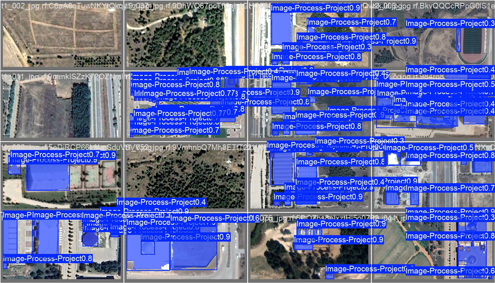
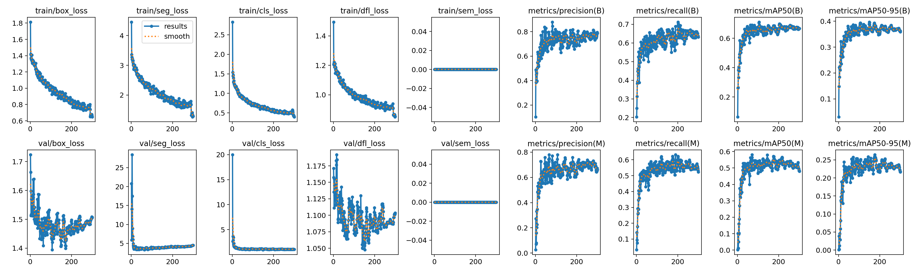

# Bilecik Building Segmentation from Satellite Imagery

Instance segmentation of buildings in satellite images of **Bilecik, Türkiye**, using **YOLOv8s-seg**.
The dataset contains images of the same locations captured at **different dates**, as a first step towards
monitoring structural change (new or demolished buildings) over time.

> Course project — *Image Processing*, Bilecik Şeyh Edebali University (Spring 2026).
> Full report (Turkish): [`docs/project_report_tr.pdf`](docs/project_report_tr.pdf)



## Highlights
- **Built from scratch**: every satellite image was collected manually from Google Earth (same locations at two different dates, `t1_*` / `t2_*`), and every building was hand-annotated with a polygon mask.
- **Model**: Ultralytics YOLOv8s-seg (COCO-pretrained), trained for 300 epochs on Google Colab.
- **Small-data strategy**: heavy *on-the-fly* augmentation (Mosaic, MixUp, Copy-Paste, scale, rotation, HSV) with AdamW and a cosine learning-rate schedule.
- **Coverage metric**: `predict.py` reports the share of each image covered by buildings, which can be compared between two dates of the same area.

## Results

Validation set, single class (`building`):

| Model | Mask Precision | Mask Recall | Mask mAP50 | Mask mAP50-95 | Box mAP50 |
|---|---|---|---|---|---|
| YOLOv8n-seg (baseline, default settings) | 69.9% | 51.2% | 51.0% | 23.6% | 58.0% |
| **YOLOv8s-seg (final)** | **71.7%** | **59.9%** | **57.1%** | **25.5%** | **68.5%** |

Moving to the larger model with AdamW, cosine LR, MixUp and Copy-Paste improved mask recall by ~9 points and mask mAP50 by ~6 points.



**Limitations:** the validation and test splits are small (20 images each), so the metrics have high variance.
Mask mAP50-95 is low because precise roof boundaries are hard to segment at this resolution.

## Dataset
I created the dataset myself — no public building dataset was used:
1. **Collection**: captured satellite images of Bilecik one by one in Google Earth, taking the same locations at two different dates (`t1_*` = older, `t2_*` = newer).
2. **Annotation**: drew a polygon mask around every building by hand in Roboflow.
3. **Export**: YOLOv8 segmentation format.

**200 original images** in total, split into:

| Split | Images |
|---|---|
| Train | 160 |
| Valid | 20 |
| Test | 20 |

- The **final model** was trained on the 160 original training images; all augmentation happened *on the fly* during training.
- The **baseline** used a Roboflow export with 3× offline augmentation (flip, 90° rotation, brightness), i.e. 480 training images.

Dataset on Roboflow Universe: [bilecik_yapi_tespiti v3](https://universe.roboflow.com/esra-yaar-s-workspace-9rdx3/bilecik_yapi_tespiti/dataset/3) (CC BY 4.0).
Download it and place `train/`, `valid/`, `test/` inside `data/` to re-train.

## Project structure
```
├── data/data.yaml          # dataset config
├── weights/best.pt         # trained YOLOv8s-seg weights
├── notebooks/              # original Colab training notebook
├── train.py                # training script (original hyperparameters)
├── predict.py              # inference + building coverage per image
├── assets/                 # result plots, sample predictions, test images
└── docs/project_report_tr.pdf
```

## Usage
```bash
pip install -r requirements.txt

# Inference with the trained model
python predict.py --source assets/test_images

# Re-train (dataset must be in data/)
python train.py
```
Annotated outputs are saved to `runs/segment/predict/`.

## Future work
- Automatic change detection: compare building masks of the same area at two dates and compute the new / removed building area in m²
- Larger and more diverse dataset (seasons, weather, other districts)
- Comparison with Mask R-CNN and SAM
- GIS integration (e.g. exporting masks as polygons for QGIS)

## Tech
Python · Ultralytics YOLOv8 · PyTorch · Google Colab · Roboflow

## License
Code is released under AGPL-3.0, in line with Ultralytics YOLOv8. The dataset is CC BY 4.0.
